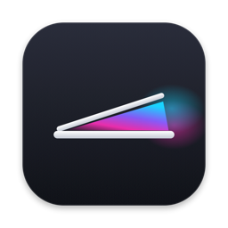
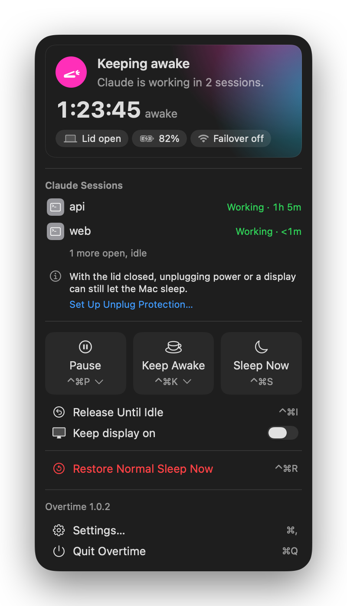
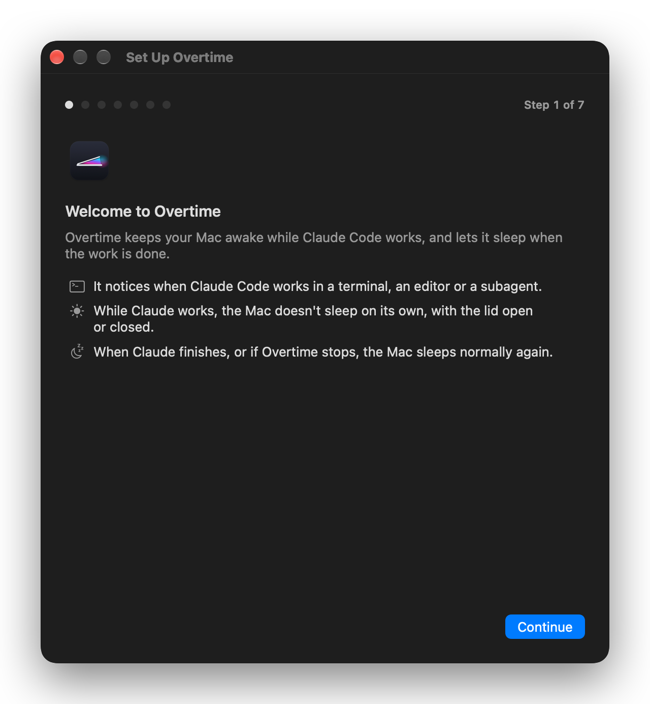
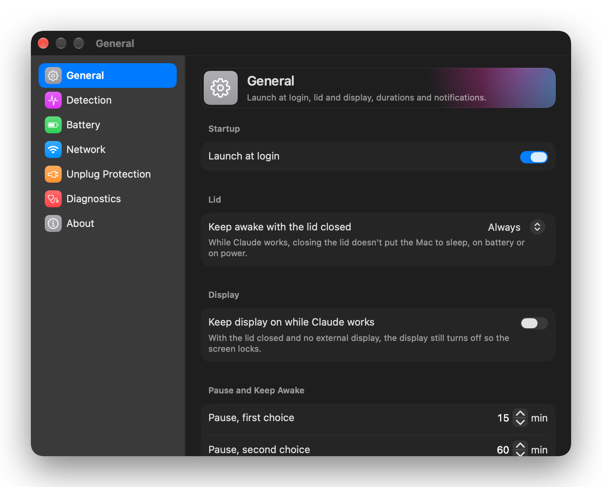
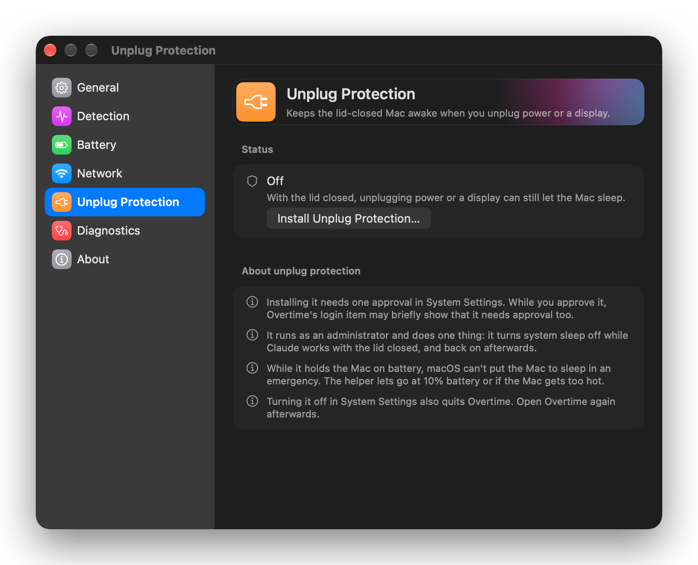

<div align="center">

<h1>Overtime</h1>
<p>Keeps your Mac awake while Claude Code works, with the lid open or closed.</p>
<p><sub>Works with Claude Code. Not affiliated with Anthropic.</sub></p>
<p>
<a href="https://github.com/ivanhernandez-dev/overtime/releases/latest">Download</a> ·
<a href="#install">Install</a> ·
<a href="#how-it-works">How it works</a> ·
<a href="#privacy">Privacy</a> ·
<a href="#troubleshooting-and-faq">FAQ</a>
</p>
<p>

<a href="LICENSE"></a>
<!-- AUTHOR DECISION A-5: set the GitHub repository description and topics (docs/RELEASING.md A-5). The description must start with the tagline above. -->
<a href="https://github.com/ivanhernandez-dev/overtime/releases/latest"></a>
<a href="https://github.com/ivanhernandez-dev/overtime/actions/workflows/ci.yml"></a>
</p>
</div>

<p align="center">
    
</p>

Claude Code keeps working when you step away, but your Mac doesn't know that: it idles to sleep, or sleeps the moment you close the lid, and the session stalls. Overtime is a menu bar app that notices when Claude Code is working and keeps the Mac awake while it works. When the work stops, or if Overtime itself fails, the Mac sleeps normally again.

## What it does

- **Lid open:** no idle sleep while Claude works. The display still sleeps as usual, unless you turn on "Keep display on while Claude works" in Settings > General.
- **Lid closed:** closing the lid doesn't put the Mac to sleep. With no external display, the display turns off so the screen locks.
- **Finds Claude Code on its own:** from its running sessions and the transcripts they write. There are no hooks and nothing to change in Claude Code, and several sessions and subagents at once are fine.
- **Lets go when the work stops:** the Mac sleeps about three minutes after Claude's last activity. You can change the timing.
- **Never stuck awake:** quitting Overtime restores normal sleep. If it crashes, hangs or is killed, a small watchdog restores it.
- **Respects you and the battery:** Apple menu > Sleep works as usual with the lid open, and Sleep Now and Pause in the panel always let the Mac sleep. On battery, Overtime lets go at 10%.
- **Stays online with the lid closed (optional):** if the network drops, it can switch the Mac to your iPhone hotspot.
- **Unplug Protection (optional):** a small helper keeps a closed Mac awake when the charger or an external display changes.
- **Updates itself** once a day, with signed updates.

## Requirements

Apple Silicon and macOS 14+ only. You also need Claude Code, in a terminal or an editor extension.

Intel Macs and macOS 13 are not supported. Staying on one architecture and a recent macOS keeps the test matrix and the power-management surface small.

## Install

### Homebrew

```sh
brew tap ivanhernandez-dev/overtime https://github.com/ivanhernandez-dev/overtime
brew install --cask ivanhernandez-dev/overtime/overtime
```

The cask lives in this repository, so the first command adds the repository as a tap. Installing by the full name trusts only this cask, so Homebrew's Tap Trust needs no extra step.

Overtime updates itself, so `brew upgrade` leaves it alone.

### Download

Get the latest release from [GitHub Releases](https://github.com/ivanhernandez-dev/overtime/releases/latest):

- **Disk image:** open `Overtime-X.Y.Z.dmg` and drag Overtime to Applications.
- **Zip:** open `Overtime-X.Y.Z.zip` and move `Overtime.app` to Applications.

Download Overtime only from this repository's Releases or with the Homebrew commands above. To check a download, see [Security](#security).

### First launch

Overtime is signed with its own certificate, not an Apple Developer ID, so macOS blocks the first open. You confirm it once, and updates from Overtime's own updater don't ask again. Homebrew installs are quarantined too, so they need the same step.

- **macOS 15 or later:** open Overtime once and close the warning. Then open System Settings > Privacy & Security, scroll down, and choose **Open Anyway** next to the message about Overtime. Confirm, and Overtime opens.
- **macOS 14:** in Applications, Control-click Overtime, choose Open, then choose Open again in the dialog.

<!-- SCREENSHOT PENDING: docs/images/gatekeeper-open-anyway.png. Save the PNG at that path, then delete this line and the closing line below.
<details>
<summary>Where to find Open Anyway</summary>


</details>
-->

## First run and permissions

The first time Overtime opens, a short guide sets it up in seven steps: Welcome to Overtime, Launch at login, Notifications, iPhone hotspot (optional), Recommended macOS settings, Unplug protection (optional), and Setup complete. On the last step there is nothing left to do: Overtime checks on its own that it can keep this Mac awake, and the result appears under Self-test in Settings > Diagnostics. You can change each choice later in Settings.

| Permission | What it is for |
|---|---|
| Launch at login | Overtime has to be running to keep the Mac awake. The first launch turns Launch at login on, and you can turn it off in Settings > General. |
| Notifications | Only when you need to act. There are five kinds: Keep-awake failed, Battery floor, Battery low when Claude starts, Lid-closed summary, and the Keep Awake reminder. You can turn each one off in Settings > General. |
| Location | Optional, and only for hotspot failover: setup asks for it only after you choose your iPhone hotspot. Since macOS 14.4, apps can see the names of nearby Wi-Fi networks only with Location access. Overtime uses it only to find and join your iPhone hotspot when the network stops working with the lid closed, never reads where you are, and never stores or sends your location. Failover works without it, but joining the hotspot is less likely to succeed. |
| Background item (Unplug Protection) | Installs the optional helper after you approve it under Allow in the Background. See [Unplug Protection](#unplug-protection). |

<p align="center">
  
</p>

## Using Overtime

Click the Overtime icon in the menu bar to open the panel. At the top, a status card shows what Overtime is doing and why, and how long it has kept the Mac awake. Chips below it show the lid, battery and network state. The Claude Sessions list shows each terminal session that is working, titled by its folder and captioned "Working · " with the time it has worked, plus one quiet line for the sessions that are open but idle. Under the list are the controls.

| Control | Shortcut | What it does |
|---|---|---|
| Pause | ⌃⌘P | Lets the Mac sleep normally for 15 Minutes, 1 Hour, Until Tomorrow or Until Resumed. While paused, it reads Resume. |
| Keep Awake | ⌃⌘K | Keeps the Mac awake without Claude for 30 Minutes, 2 Hours or Until Stopped. It still lets go at the battery limit. While it holds, it reads Stop Keeping Awake. |
| Release Until Idle | ⌃⌘I | Lets go of the current hold while Claude keeps working. Overtime holds again after Claude goes idle and starts working again. |
| Keep display on | None | Keeps the display on while Claude works. It is the same setting as "Keep display on while Claude works" in Settings > General, and a change in either place shows in the other. |
| Sleep Now | ⌃⌘S | Puts the Mac to sleep. While Claude works, it asks first: "Claude is working. Sleep anyway?" Choose Sleep Anyway or Keep Working. |
| Restore Normal Sleep Now | ⌃⌘R | Clears every hold Overtime has set. It is the first step of the [emergency reset](#if-the-mac-wont-sleep). |
| Settings… | ⌘, | Opens Settings. |
| Quit Overtime | ⌘Q | Quits Overtime. Quitting restores normal sleep. |

The shortcuts work while the panel is open, and in the window Overtime shows when its menu bar icon is hidden.

The menu bar icon has eight states, each with its own shape, not only its own color: idle, keeping awake, lid closed, waiting to release, paused, battery low, kept awake by you, and error.

Settings has seven panes, in this order:

- **General:** Launch at login, the display and notifications.
- **Detection:** How Overtime tells that Claude is working.
- **Battery:** When Overtime lets the Mac sleep on battery.
- **Network:** Switching to your iPhone hotspot when the network fails.
- **Unplug Protection:** Keeps the lid-closed Mac awake when you unplug power or a display.
- **Diagnostics:** Detection health, the self-test and an export for bug reports.
- **About:** Version, updates, acknowledgements and uninstall.

<p align="center">
  
</p>

## How it works

- **Detect.** Claude Code counts as working while a Claude session in a terminal keeps its own `caffeinate` running, or while a transcript under `~/.claude/projects` (subagents included) was written in the last 2 minutes. A Claude Code session that sets its own CLAUDE_CONFIG_DIR is watched automatically while it runs, and you can add folders in Settings > Detection. Transcripts whose entrypoint is on the ignored list (by default `sdk-*`, which covers `claude -p` and Agent SDK automations) don't count, and neither do background tasks or `/loop` wake-ups. There are no hooks and no AI: only system state.
- **Hold.** With the lid open, Overtime holds a standard macOS power assertion against idle sleep and renews it while Claude works. macOS drops it within five minutes if Overtime stops renewing it, and at once when Overtime exits. With the lid closed, it uses a public macOS power-management call that tells the Mac not to sleep on lid close, without administrator rights, and sets it again when macOS resets it.
- **Watch.** A small watchdog process runs next to the app. If Overtime crashes, hangs or is killed, the watchdog restores normal sleep first and then reopens Overtime, at most 3 times in 10 minutes. A hold left behind is cleared the next time Overtime starts, and restarting the Mac clears the lid-close setting.
- **Release.** The Mac sleeps about three minutes after Claude's last activity: the 2-minute Transcript window plus the 1-minute Release grace, both in Settings > Detection. With the lid closed and no external display, Overtime checks about 30 seconds after letting go that the Mac went to sleep, and asks for sleep if it didn't.
- **Stay out of the way.** With the lid closed and no external display, the display turns off so the screen locks; an external display is never turned off, and you can keep the display on with "Keep display on while Claude works". On battery, Overtime lets go at 10% and holds again on power or at 20%, both in Settings > Battery. Apple menu > Sleep works as usual with the lid open, and Sleep Now and Pause in the panel always let the Mac sleep.

Network failover is off until you choose your iPhone hotspot, during setup or in Settings > Network, or turn on Auto-detect iPhone hotspot. It acts only with the lid closed while Claude works. It checks every 10 seconds, asking api.anthropic.com and then captive.apple.com, with no cookies and no cache. After 3 failed checks it joins the hotspot, and it switches back to your usual network when you open the lid.

The design decisions, with the evidence behind each, are in [`docs/adr/`](docs/adr/).

## Unplug Protection

Without Unplug Protection, a closed Mac can still go to sleep while Claude works when you plug the charger back in, connect or disconnect an external display, or unplug the charger while an external display is connected. Unplug Protection prevents that. It is off until you turn it on in Settings > Unplug Protection, and installing it needs one approval in System Settings > General > Login Items & Extensions, under Allow in the Background.

It is a small helper that runs as an administrator and does one thing: while Claude works with the lid closed, it turns system sleep off (the `SleepDisabled` setting that `pmset -g` shows), and it turns it back on afterwards. While it holds, macOS can't put the Mac to sleep even in an emergency, so the helper keeps its own limits. It turns system sleep back on when:

- the lid opens;
- the battery reaches 10%, on any power source, or macOS raises a low-battery warning;
- the Mac gets too hot;
- the power or thermal state can't be read;
- Overtime stops checking in for 55 to 60 seconds, for example because it crashed or hung.

The helper accepts requests only from the Overtime app, and it is the only part of Overtime that runs as root. Without it, Overtime needs no administrator rights.

<p align="center">
  
</p>

## Privacy

Overtime collects no telemetry.

**What it reads, on your Mac only:**

- the list of your own running processes, to spot Claude Code sessions;
- when the transcripts in its folders were last written, and the first 64 KB of each transcript, only to read which kind of client wrote it;
- the power state: lid, battery, charger, displays and idle time;
- for network failover only: the Wi-Fi interface, the router address and your known networks, and, with Location allowed, a scan for nearby networks with your hotspot's name.

**What it sends:** two kinds of requests, and nothing about you or your work.

- the daily update check against GitHub;
- the failover connectivity check, only while failover is armed with the lid closed: a request to api.anthropic.com and to Apple's captive-portal page, with no cookies and no cache.

**What it never sends:** transcript contents, prompts, file names or your location.

Settings and state live in `~/Library/Application Support/Overtime`, and logs in `~/Library/Logs/Overtime` (the decision log is `overtimed.log`). Diagnostics stay on your Mac unless you export them yourself with Export Diagnostics in Settings > Diagnostics. The export keeps process names, so read it before you share it.

<!-- AUTHOR DECISION A-4: confirm the statement about what the diagnostics export contains before the first public release (docs/RELEASING.md A-4). -->

## Updates

Once a day, Overtime asks GitHub whether a newer version exists. No usage data is sent. The update feed and every update are signed, and Overtime refuses any that doesn't verify.

When an update is waiting, a quiet reminder appears in the panel and in Settings > About, with no notification. Choose "Review Update…" to see it. "Download and install updates automatically" is off until you turn it on in Settings > About, and an automatic update installs the next time Overtime quits. You can also choose "Check for Updates…" in Settings > About at any time.

## Security

- **Signing.** Overtime is signed with its own long-lived certificate, not an Apple Developer ID. That certificate stays the same across releases, which is why permissions and Unplug Protection survive updates.
- **Hardened Runtime with `disable-library-validation`.** Hardened Runtime is on. It carries the `disable-library-validation` exception so that Sparkle, the update framework, can load without an Apple Team ID. The exception goes away with the first Developer ID release.

<details>
<summary>The helper and modified copies</summary>

- **If you use Unplug Protection.** The helper accepts only an app signed with Overtime's certificate, but it checks the app's main program only. Because of the exception above, a modified copy of the app with an added library could ask the helper to keep sleep off. The helper's own limits still apply (lid open, 10% battery, low-battery warning, heat, an unreadable power state), but nothing else would end it. This risk ends with the first Developer ID release.
- **Check a download.** Each release has a `SHA256SUMS` file. Put it in the same folder as your download and run `shasum -a 256 -c --ignore-missing SHA256SUMS`; each file you downloaded should read `OK`. To check the installed app's signature, run `codesign -d -r- /Applications/Overtime.app`; the output names the certificate root `9c54a8e3e576cc8e7eb6d5a2dc63aa7607b821ce`.

</details>

<!-- AUTHOR DECISION security contact: choose how people report a security issue (for example private vulnerability reporting on GitHub, or a SECURITY.md) and add it here. No channel exists yet. -->

## Troubleshooting and FAQ

### If the Mac won't sleep

1. Open the Overtime panel in the menu bar and choose **Restore Normal Sleep Now**.
2. If the app doesn't respond, run `/Applications/Overtime.app/Contents/MacOS/Overtime --reset` in Terminal.
3. If `pmset -g` still shows `SleepDisabled 1`, run `sudo pmset -a disablesleep 0`.

<details>
<summary>The Mac slept with the lid closed while Claude was working</summary>

Without Unplug Protection, a closed Mac can sleep when you plug the charger back in, connect or disconnect an external display, or unplug the charger while an external display is connected. The battery limit in Settings > Battery also lets go on purpose. The Lid-closed summary notification tells you what happened, and the decision log is `~/Library/Logs/Overtime/overtimed.log`.

</details>

<details>
<summary>Overtime doesn't notice Claude Code</summary>

Open Settings > Diagnostics: Detection health lists transcript folders that are missing or can't be read. Settings > Detection marks such a folder with a warning sign, and you can add folders there. Overtime always watches `~/.claude/projects`, and a Claude Code session that sets its own CLAUDE_CONFIG_DIR is watched while it runs. `claude -p` and Agent SDK scripts are ignored on purpose; you can change that under Ignored entrypoints in Settings > Detection.

</details>

<details>
<summary>The Overtime icon isn't in the menu bar</summary>

On macOS 26 or later, open System Settings > Menu Bar and allow Overtime. Opening Overtime again from Applications or Spotlight shows a window with the same controls.

</details>

<details>
<summary>Can I use it with another keep-awake tool?</summary>

Overtime warns when it finds another tool that also manages sleep, with a message that ends "Running both is unsupported." A lid-closed mode of another tool uses the same macOS setting as Overtime, so quit that tool while Overtime runs.

</details>

<details>
<summary>Does it keep the screen on?</summary>

Not by default. Turn on Keep display on in the menu bar panel, or "Keep display on while Claude works" in Settings > General; both are the same setting. With the lid closed and no external display, the display still turns off so the screen locks. An external display is never turned off.

</details>

<details>
<summary>Why doesn't a dev server or /loop keep the Mac awake?</summary>

Only foreground Claude work counts, by design: background tasks and `/loop` wake-ups don't. Use Keep Awake for anything else.

</details>

<details>
<summary>Is it safe to run with the lid closed in a bag?</summary>

Overtime lets go about three minutes after Claude stops and at the battery limit, and if Overtime fails, its watchdog restores normal sleep. With Unplug Protection on, the helper also lets go when the Mac gets too hot. Ventilation is still your call.

</details>

<details>
<summary>Why isn't it on the App Store?</summary>

Overtime is not sandboxed. It is distributed through GitHub Releases and the Homebrew cask in this repository.

</details>

<details>
<summary>Does it work on an Intel Mac or macOS 13?</summary>

No. Overtime is Apple Silicon and macOS 14 or later only, which keeps the test matrix small.

</details>

<details>
<summary>How do I report a bug?</summary>

Choose Export Diagnostics in Settings > Diagnostics, read the archive, then open an issue at https://github.com/ivanhernandez-dev/overtime/issues and attach it.

</details>

## Uninstall

The simplest way is in the app: Settings > About > "Uninstall Overtime…". It stops keep-awake, removes Unplug Protection and the login item, makes sure system sleep is back on, and moves Overtime to the Trash. Tick "Also remove settings, state and logs" to remove those too.

If the app is already gone, or you prefer a script, run `scripts/uninstall.sh` from this repository, or the copy inside the app at `Overtime.app/Contents/Resources/uninstall.sh`:

```sh
/bin/bash scripts/uninstall.sh --dry-run
/bin/bash scripts/uninstall.sh --purge
```

`--dry-run` prints what it would do and changes nothing. `--purge` also removes settings, state and logs. Run the script as yourself, not with `sudo`: `Overtime --uninstall` refuses to run as root. With the app already gone, the script asks for your administrator password to stop the helper, and it ends by asking you to remove Overtime from System Settings > General > Login Items & Extensions yourself.

If you installed with Homebrew:

```sh
brew uninstall --zap --cask overtime
```

A plain `brew uninstall` only quits and removes the app. It leaves Unplug Protection and your settings in place, which is what `--zap` removes.

Uninstalling never touches:

- a `SleepDisabled` that Overtime did not set, for example one you set yourself. If Overtime can't tell who set it, it leaves it on and tells you how to turn sleep back on;
- the notification, Location and other privacy records macOS keeps for Overtime (System Settings manages those);
- files of other apps.

## Build from source

You need Xcode 27 and XcodeGen 2.46.0.

```sh
xcodegen generate
xcodebuild build -project Overtime.xcodeproj -scheme Overtime -configuration Release \
  -destination 'generic/platform=macOS' -derivedDataPath build CODE_SIGN_IDENTITY=-
```

The app is at `build/Build/Products/Release/Overtime.app`. A source build differs from a release in three ways:

- **Permissions reset on every rebuild.** The build is signed ad hoc, so macOS treats each build as a new app and asks again for notifications, Location and the login item.
- **Unplug protection does not work.** The helper accepts only the app signed with Overtime's own certificate.
- **The updater offers the official release.** It sees the signed release as an update. To stay on your build, turn off "Check for updates automatically" in Settings > About.

## Contributing

Run the tests with:

```sh
swift test --package-path Packages/OvertimeCore
swift test --package-path Packages/OvertimeRuntime
/bin/bash scripts/tests/run.sh
```

All code, UI text, logs and docs are in English.

<!-- AUTHOR DECISION contribution policy: decide whether pull requests are welcome, whether an issue should come first, and whether to add a CONTRIBUTING.md, then write the policy here. -->

## License and acknowledgements

Overtime is released under the MIT License with the Commons Clause; see [LICENSE](LICENSE). You may use it anywhere, including at work in a company, and you may copy and change it as long as you keep the copyright and license notice. You may not sell it, or charge for a product or service whose value comes entirely or substantially from it. The 0.1 source published before 2026-10-15 stays under the plain MIT License.

[NOTICE](NOTICE) credits the code Overtime includes: [Sparkle](https://sparkle-project.org), the update framework, with the licenses it carries, and a window pattern adapted from [Lidless](https://github.com/nghialuong/Lidless) (MIT). Settings > About > "Show Acknowledgements…" shows both files in the app.

## For maintainers

The release checklist, the one-time setup and the decisions to take before the first release are in [docs/RELEASING.md](docs/RELEASING.md).

<p align="center"><sub>Works with Claude Code. Not affiliated with Anthropic.</sub></p>
